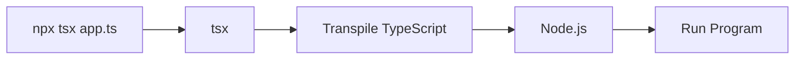

# TypeScript
TypeScript stands in an unusual relationship to JavaScript. TypeScript offers all of JavaScript’s features, and an additional layer on top of these: TypeScript’s type system.

For example, JavaScript provides language primitives like string and number, but it doesn’t check that you’ve consistently assigned these. TypeScript does.

This means that your existing working JavaScript code is also TypeScript code. The main benefit of TypeScript is that it can highlight unexpected behavior in your code, lowering the chance of bugs.

# Reference
https://www.typescriptlang.org/docs/handbook/intro.html

https://www.typescriptlang.org/docs/handbook/typescript-in-5-minutes.html


You’ll see that there are two syntaxes for building types: Interfaces and Types. You should prefer interface. Use type when you need specific features.
https://www.typescriptlang.org/play/?e=83#example/types-vs-interfaces

## To learn the type of a variable, use typeof:
| Type      | Predicate                          |
|-----------|------------------------------------|
| string    | `typeof s === "string"`            |
| number    | `typeof n === "number"`            |
| boolean   | `typeof b === "boolean"`           |
| undefined | `typeof undefined === "undefined"` |
| function  | `typeof f === "function"`          |
| array     | `Array.isArray(a)`                 |


# Commands
***Why developers use tsx***

> ***It is faster and simpler than the traditional TypeScript workflow:***<br>
✅ No manual compilation step <br>
✅ Supports ES Modules automatically <br>
✅ Works with .ts, .tsx, .mts, and .cts files <br>
✅ Great for scripts, utilities, and development

```bash
# Run sample TypeScript
npx tsx user.ts

npx tsx generics.ts
```
> *** both npx and tsx are Node.js tools***<br>
The flow is roughly:<br>

✅ So tsx makes things easier, but Node.js is still underneath.

# Question & Answer

> ***How is the Typical Setup done?
```bash
# 1. Install Node.js first - since npm comes with Node.js

# 2. Install TypeScript
npm install -g typescript

# 3. Check vestions
node --version
tsc --version

# 4. Compile TypeScript
tsc app.ts

# 5. Run the generated JavaScript
node app.js

```
---

> ***Browser applications***

Even if you're building a React web app:

TypeScript
App.tsx

you still usually need Node.js for the build tools:<br>

✅ Vite<br>
✅ React<br>
✅ Next.js<br>
✅ Angular<br>
✅ TypeScript compiler<br>
✅ ESLint<br>

All of these run on Node.js during development.